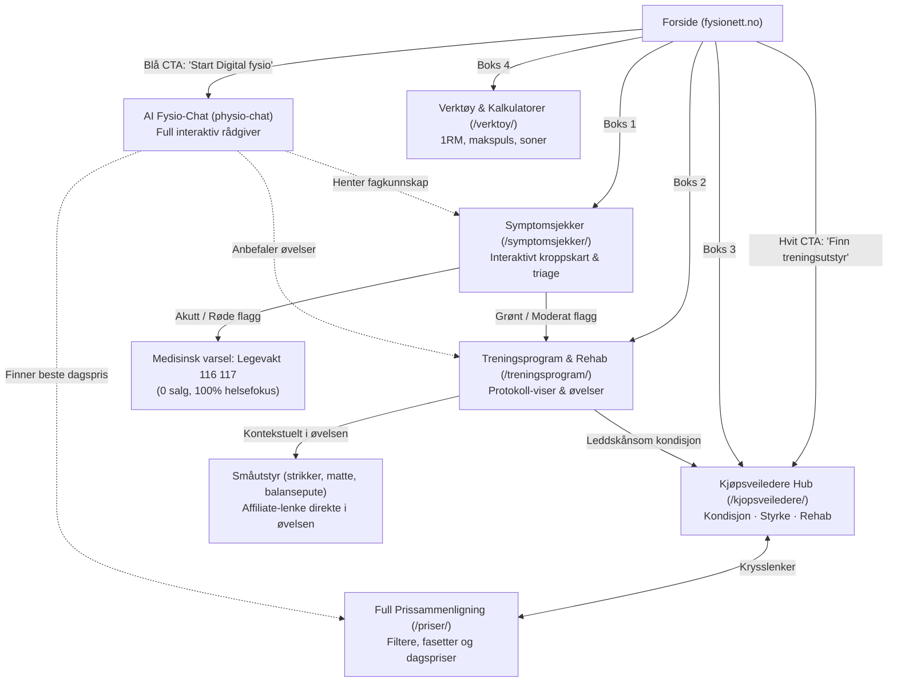

# Helhetlig implementeringsplan: Fysionett & Gear Engine

Dette dokumentet definerer den overordnede arkitekturen, brukerreisene og implementeringsrekkefølgen for **Fysionett**. Planen knytter sammen **AI-assistenten (Digital fysio)**, **Symptomsjekkeren (Triage)**, **Rehabprotokoller (Exercises)**, **Kjøpsveiledere (Gear Picker)** og **Prissammenligningsmotoren**.

---

## 1. Økosystem og interaksjonskart

Brukeren har flere veier inn, men alle moduler deler samme underliggende kunnskapsbase:

---

## 2. Forsiden: Innganger og roller

Forsiden samler konseptet under overskriften **«Din fysioterapeut på nett»**:

### Hero-seksjonen
- **Overskrift:** *Din fysioterapeut på nett*
- **Ingress:** *Finn årsaken til smertene, lag skreddersydde treningsprogram og få hjelp til å velge riktig treningsutstyr.*
- **Primær CTA (Blå knapp): «Start Digital fysio ›»**
  - Åpner **AI-chatten (`physio-chat`)** i en dedikert, tiltalende modal eller ekspanderende skuff.
  - AI-chatten er trent på triage-kriteriene, øvelsesbiblioteket og produktfeedene, slik at brukeren kan stille frie spørsmål (*«Hvilken ergometersykkel er best for knær med artrose?»* eller *«Jeg tråkket over i går, hva bør jeg gjøre?»*).
- **Sekundær CTA (Hvit knapp): «Finn riktig treningsutstyr»**
  - Scroller direkte ned til velgerne eller leder til `/kjopsveiledere/`.

### De 4 kjerne-boksene
1. **Symptomsjekker (tidligere "Digital fysio" i boksen):**
   - Ikon: Puls/bølge.
   - Tekst: *Kartlegg smerter og plager via vårt interaktive kroppskart.*
   - Mål: Leder til `/symptomsjekker/` (`modules/triage`).
2. **Treningsprogram:**
   - Ikon: Sjekkliste.
   - Tekst: *Faseinndelte opptreningsprotokoller og kvalitetssikrede øvelser.*
   - Mål: Leder til `/treningsprogram/` (`modules/exercises`).
3. **Kjøpsveiledere:**
   - Ikon: Handlekurv.
   - Tekst: *Finn treningsutstyret som passer kroppen din og budsjettet ditt.*
   - Mål: Leder til `/kjopsveiledere/` (`modules/gear-picker`).
4. **Verktøy:**
   - Ikon: Verktøy/skiftenøkkel.
   - Tekst: *Kalkulatorer for 1RM, pulssoner, belastning og progresjon.*
   - Mål: Leder til `/verktoy/`.

### Seksjonen under: "Finn riktig treningsutstyr"
- Viser de 4 mest populære kjøpsveilederne med «Ta testen»:
  - **Tredemølle** ➔ Åpner `[gear_engine_gear_picker type="treadmill"]`
  - **Ergometersykkel** ➔ Åpner `[gear_engine_gear_picker type="ergometersykkel"]`
  - **Romaskin** ➔ Åpner `[gear_engine_gear_picker type="romaskin"]`
  - **Multigym** ➔ Åpner `[gear_engine_gear_picker type="multigym"]`

---

## 3. Modul for modul: Struktur og samspill

### Modul 1: Symptomsjekker (`modules/triage`)
- **Oppgave:** Systematisk kartlegge smerter (kroppsdel, varighet, smertetype, røde flagg).
- **Utfall:**
  - **Røde flagg / Akutt:** Henviser umiddelbart til legevakt (116 117) eller fastlege. Null salgspress.
  - **Grønt / Moderat:** Presenterer differensialdiagnoser, fysiologisk forklaring, råd om avlastning – og en tydelig handlingsknapp:
    > **«Gå til tilpasset opptreningsprogram for ditt kne ➔»** (sender med `region` og `dx`-kode).

### Modul 2: Treningsprogrammer & Rehabprotokoller (`modules/exercises`)
Her presenteres opptreningen på en strukturert og pedagogisk måte:
- **Protokolloppsett:**
  - **Fase 1: Akutt / Avlastning:** Skånsomme sirkulasjonsøvelser, smertereduksjon.
  - **Fase 2: Mobilitet & Lett styrke:** Isometriske øvelser, bevegelsesutslag.
  - **Fase 3: Funksjonell styrke & Retur:** Dynamiske øvelser, hopp/løp hvis aktuelt.
- **Kontekstuell utstyrsanbefaling (Etisk & Hjelpsomt):**
  - I hver øvelsesboks der utstyr brukes:
    - *«Øvelse: Sideliggende benløft med miniband»* ➔ Liten boks: *«Anbefalt utstyr: Sett med minibands (lett motstand) [Se forhandlere / Kjøp hos Gymgrossisten / Tights]»*.
    - *«Alternativ uten utstyr: Kan utføres uten motstandsbånd i starten.»*
  - I toppen av protokollen under oppvarming:
    - *«Anbefalt oppvarming: 10 minutter lett rotasjon på ergometersykkel eller gange med god demping. [Trenger du apparat hjemme? Prøv vår veileder for leddskånsomt utstyr ➔]»*.

### Modul 3: Kjøpsveiledere (`modules/gear-picker`)
- **Oppgave:** 1-minutters interaktiv guide som finner optimale modeller og dagspriser.
- **Kategori-inndeling på `/kjopsveiledere/`:**
  - 🏃 **Kondisjon:** Tredemølle, Romaskin, Ergometersykkel, Spinningsykkel, Ellipse.
  - 🏋️ **Styrke:** Justerbare manualer, Multigym, Vektbenk, Knebøystativ.
  - 🩺 **Rehab & Helse:** Skånsom kondisjon (lav innstigning), Balanse & koordinasjon, Pedaltrener.
- **Egenskaper:**
  - All logikk og spørsmål drives av JSON (`configs/<type>.json`).
  - Dagens tilbud med veksling mellom største kroneavslag og prosent.
  - Sammenligningsskuff og transparent scoringsveiledning.

### Modul 4: AI Fysio-Chat (`modules/physio-chat`)
- **Oppgave:** Den samlende digitale assistenten (åpnes via den blå «Start Digital fysio»-knappen).
- **Arkitektur:**
  - Bygget på `class-gear-engine-chat-agent.php`.
  - Kan motta åpne henvendelser: *«Hva slags øvelser hjelper mot stiv nakke på hjemmekontor?»* ➔ Svarer med råd, trekker inn 2 relevante øvelser fra `exercises`, og foreslår eventuelt en massasjeball eller heve/senk-tips.
  - Kan hjelpe med utstyr: *«Jeg veier 105 kg og vil ha en romaskin under 12 000 kr»* ➔ Slår opp i `gear-picker` og gir forslag med riktig vektkapasitet.

### Modul 5: Prissammenligning (Planlagt utvidelse)
- **Oppgave:** For faste brukere som vet nøyaktig hva de ser etter og vil søke i hele produktbasen på tvers av 6+ forhandlere.
- **Arkitektur:**
  - Fasettert filtrering (pris, butikk, merke, svinghjul, motortype, lagerstatus).
  - Krysskobling: Lenker opp til den interaktive veilederen for de som blir usikre.

---

## 4. Trinnvis implementeringsplan

### Fase 1: Finjustere inngangene og forsiden (Fullført / Påbegynt)
- [x] Kategori-agnostisk frontend for `gear-picker` (tredemølle, romaskin, etc.).
- [x] Dagens tilbud med prosent vs. kroneavslag og fjernet dobbel badge.
- [x] Opprette dedikert landingsside for Kjøpsveiledere (`/kjopsveiledere/`) med tab-kategorier (Kondisjon, Styrke, Rehab) via `[gear_engine_gear_picker_hub]`.
- [ ] Oppdatere forsidens 4 bokser: Endre første boks til **«Symptomsjekker»** og koble den blå knappen til **AI Fysio-Chat**.

### Fase 2: Forbinde Triage med Treningsprogrammer og Utstyrsveiledere
- [x] Sikre at fullført Triage for en kroppsdel (f.eks. kne) sender brukeren direkte til riktig fase i `/treningsprogram/?region=kne&dx=artrose`.
- [x] Legge inn 2–3 diskrete hjelpemidler i bunnen av ikke-kritiske Triage-resultater (strikk, balansepute, ispose) med gratisalternativer og bro til Kjøpsveiledere (`/kjopsveiledere/?kategori=rehab`).

### Fase 3: Strukturere Rehabprotokoller (`exercises`)
- [x] Etablere mal for visning av protokoller (faseinndelt, øvelseskort med video/GIF, dosering og fullt Material 3-design).
- [x] Legge inn et diskret felt for «Påkrevd / Anbefalt utstyr» per øvelse som automatisk genererer tilknyttede produktlenker og gratis hverdagsalternativer.

### Fase 4: Integrere AI-chatten som universell rådgiver (`physio-chat`)
- [ ] Knytte den blå hero-knappen til åpning av chat-grensesnittet.
- [ ] Sikre at AI-agenten har oppdaterte "tools" til å hente øvelser fra protokollene og produkter fra feedene.

### Fase 5: Den store prissammenligningsmodulen
- [ ] Importere og tilpasse den fasetterte tabell-/katalogvisningen fra forrige versjon.
- [ ] Etablere toveis lenking mellom kjøpsveilederne og prissammenligningskatalogen.

