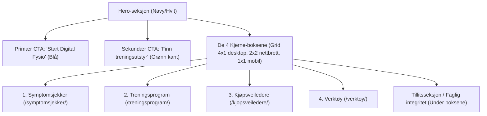

# Oppskrift for Forsiden på Fysionett (GenerateBlocks & GeneratePress Pro)

Denne oppskriften beskriver hvordan forsiden på **fysionett.no** struktureres ved hjelp av **GeneratePress Pro** og **GenerateBlocks**. Ingen deler av forsiden hardkodes i pluginen – forsiden bygges rent i WordPress-editoren og kobles sammen med pluginens kortkoder og URL-strukturer.

---

## 1. Sideoversikt & URL-struktur

Før forsiden settes opp, bør du ha opprettet følgende standardsider i WordPress med tilhørende kortkoder:

| Side-tittel | Permalenke / URL | Kortkode | Beskrivelse |
|---|---|---|---|
| **Forside** | `/` | *(Ingen – ren blokkside)* | Hovedinngang, Hero, 4 handlingskort, verktøy og tillitsvegg. |
| **Symptomsjekker** | `/symptomsjekker/` | `[gear_engine_triage_picker]` | Interaktiv klinisk symptomsjekker for 11 kroppsregioner. |
| **Treningsprogrammer** | `/treningsprogram/` | `[gear_engine_protocol]` | Evidensbaserte rehabiliteringsprotokoller og fasebaserte øvelser. |
| **Kjøpsveiledere** | `/kjopsveiledere/` | `[gear_engine_gear_picker_hub]` | Utstyrsvelger med 3 kategorier (Kondisjon, Styrke, Rehab & Helse). |
| **Digital Fysio** | `/fysio-chat/` | `[gear_engine_physio_chat]` | Fullskjerms AI Fysio-Chat (kan også åpnes i modal/skuff). |
| **Verktøy** | `/verktoy/` | *(Beregninger/kalkulatorer)* | Praktiske kalkulatorer for 1RM, pulssoner, belastning og restitusjon. |

---

## 2. Visuell design og fargetokens (M3 / Fysionett)

GenerateBlocks-oppsettet følger designprofilen definert i `gear-engine-tokens.css`:

- **Mørk blå (Navy 900):** `#1A2A3A` (hovedfarge for overskrifter, primærknapper og kontraster)
- **Fysio-grønn (Teal / Emerald):** `#00A878` (aksenter, suksess-merker, tillitsikoner)
- **Bakgrunn (Offwhite / Surface):** `#F8FAFC` eller `#FFFFFF`
- **Kortkant (Border):** `#E2E8F0`
- **Brødtekst (Body):** `#374151`
- **Sekundærtekst (Muted):** `#64748B`

---

## 3. Seksjonsoppbygging på Forsiden



---

## 4. Detaljert oppsett per seksjon

### A. Hero-seksjon (Topp)
- **Bakgrunn:** Hvit eller lys grå (`#F8FAFC`).
- **Pill over overskrift:**
  - Tekst: `● Nyhet: Digital fysioterapeut og smarte utstyrsguider`
  - Bakgrunn: `#E6F7F1` (lys grønn), tekst: `#00A878` (grønn).
- **Hovedtittel (H1):** `Fysioterapi, tilpassede øvelser og riktig treningsutstyr.`
- **Ingress (P):** `Klinisk kvalitetssikrede rehabiliteringsprogrammer, interaktiv symptomsjekker og kjøpsveiledere som finner apparater tilpasset din kropp og dine ledd.`
- **Knappepar (Button Container):**
  - **Knapp 1 (Primær CTA):**
    - Tekst: `✦ Start Digital Fysio`
    - Farge: Bakgrunn `#1A2A3A`, tekst `#FFFFFF`. Hover: `#2C4257`.
    - Lenke: `/fysio-chat/` (eller modal-trigger).
  - **Knapp 2 (Sekundær CTA):**
    - Tekst: `Finn treningsutstyr ›`
    - Farge: Hvit bakgrunn, kant `#CBD7E6`, tekst `#1A2A3A`. Hover: `#F1F5F9`.
    - Lenke: `/kjopsveiledere/`.

---

### B. De 4 Handlingsboksene (Kjernefunksjoner)

Sett opp en **GenerateBlocks Grid** med 4 like store kolonner (desktop 25%, nettbrett 50%, mobil 100%):

#### Boks 1: Symptomsjekker
- **Status/Badge:** `1–2 min test`
- **Tittel (H3):** `Symptomsjekker` *(Merk: Endret fra "Finn diagnose" til Symptomsjekker i tråd med planen)*
- **Beskrivelse:** `Svar på enkle spørsmål om smertene dine for å kartlegge mulige årsaker, røde flagg og anbefalt tiltak.`
- **Handling / Lenke:** `/symptomsjekker/` ➔ `Ta testen ›`

#### Boks 2: Treningsprogrammer
- **Status/Badge:** `Evidensbasert`
- **Tittel (H3):** `Treningsprogrammer`
- **Beskrivelse:** `Strukturerte rehabiliteringsfaser med videoveiledning, dosering og alternativer som kan gjøres hjemme.`
- **Handling / Lenke:** `/treningsprogram/` ➔ `Se programmer ›`

#### Boks 3: Kjøpsveiledere
- **Status/Badge:** `3 kategorier`
- **Tittel (H3):** `Kjøpsveiledere`
- **Beskrivelse:** `Finn tredemøller, romaskiner, ergometersykler eller leddavlastende hjelpemidler tilpasset kroppsvekt og budsjett.`
- **Handling / Lenke:** `/kjopsveiledere/` ➔ `Gå til veilederne ›`

#### Boks 4: Verktøy & Kalkulatorer
- **Status/Badge:** `Kalkulatorer`
- **Tittel (H3):** `Verktøy`
- **Beskrivelse:** `Praktiske beregninger for 1RM-styrke, pulssoner, belastningsstyring og restitusjon.`
- **Handling / Lenke:** `/verktoy/` ➔ `Åpne verktøy ›`

---

## 5. Ferdig GenerateBlocks-kode (Kopier & Lim inn)

Du kan lime inn blokk-koden under direkte i WordPress-editoren ved å bytte visning til **Koderedigering** (*Code Editor*: trykk `Ctrl + Shift + Alt + M` eller velg de 3 prikkene øverst til høyre ➔ *Koderedigering*):

```html
<!-- wp:generateblocks/container {"uniqueId":"fysio-hero-wrapper","backgroundColor":"#f8fafc","paddingTop":"60","paddingBottom":"60","paddingLeft":"20","paddingRight":"20"} -->
<div class="gb-container gb-container-fysio-hero-wrapper">
	<!-- wp:generateblocks/container {"uniqueId":"fysio-hero-inner","maxWidth":1140,"isGrid":false} -->
	<div class="gb-container gb-container-fysio-hero-inner">
		
		<!-- TOPP-BADGE -->
		<!-- wp:generateblocks/headline {"uniqueId":"fysio-badge","element":"p","backgroundColor":"#e6f7f1","textColor":"#00a878","fontSize":13,"fontWeight":"700","paddingTop":"6","paddingBottom":"6","paddingLeft":"14","paddingRight":"14","borderRadiusTopLeft":"9999","borderRadiusTopRight":"9999","borderRadiusBottomLeft":"9999","borderRadiusBottomRight":"9999","display":"inline-block","marginBottom":"20"} -->
		<p class="gb-headline gb-headline-fysio-badge">● Fysioterapi &amp; Smarte Helseveiledere</p>
		<!-- /wp:generateblocks/headline -->

		<!-- HOVEDTITTEL -->
		<!-- wp:generateblocks/headline {"uniqueId":"fysio-h1","element":"h1","fontSize":42,"fontSizeMobile":30,"lineHeight":1.2,"fontWeight":"800","textColor":"#1a2a3a","marginBottom":"18"} -->
		<h1 class="gb-headline gb-headline-fysio-h1">Fysioterapi, tilpassede øvelser og riktig treningsutstyr.</h1>
		<!-- /wp:generateblocks/headline -->

		<!-- INGRESS -->
		<!-- wp:generateblocks/headline {"uniqueId":"fysio-ingress","element":"p","fontSize":18,"lineHeight":1.6,"textColor":"#4a5a6a","maxWidth":760,"marginBottom":"32"} -->
		<p class="gb-headline gb-headline-fysio-ingress">Klinisk kvalitetssikrede rehabiliteringsprogrammer, interaktiv symptomsjekker og kjøpsveiledere som finner apparater tilpasset din kroppsvekt og dine ledd.</p>
		<!-- /wp:generateblocks/headline -->

		<!-- HERO-KNAPPER -->
		<!-- wp:generateblocks/button-container {"uniqueId":"fysio-hero-btns","marginBottom":"48"} -->
		<div class="gb-button-wrapper gb-button-wrapper-fysio-hero-btns">
			<!-- wp:generateblocks/button {"uniqueId":"fysio-btn-chat","url":"/fysio-chat/","backgroundColor":"#1a2a3a","backgroundColorHover":"#2c4257","textColor":"#ffffff","textColorHover":"#ffffff","fontWeight":"700","fontSize":16,"paddingTop":"14","paddingBottom":"14","paddingLeft":"26","paddingRight":"26","borderRadiusTopLeft":"9999","borderRadiusTopRight":"9999","borderRadiusBottomLeft":"9999","borderRadiusBottomRight":"9999","marginRight":"12"} -->
			<a class="gb-button gb-button-fysio-btn-chat" href="/fysio-chat/">✦ Start Digital Fysio</a>
			<!-- /wp:generateblocks/button -->

			<!-- wp:generateblocks/button {"uniqueId":"fysio-btn-picker","url":"/kjopsveiledere/","backgroundColor":"#ffffff","backgroundColorHover":"#f1f5f9","textColor":"#1a2a3a","textColorHover":"#1a2a3a","fontWeight":"600","fontSize":16,"paddingTop":"14","paddingBottom":"14","paddingLeft":"26","paddingRight":"26","borderRadiusTopLeft":"9999","borderRadiusTopRight":"9999","borderRadiusBottomLeft":"9999","borderRadiusBottomRight":"9999","borders":{"top":{"color":"#cbd7e6","width":"1px"},"right":{"color":"#cbd7e6","width":"1px"},"bottom":{"color":"#cbd7e6","width":"1px"},"left":{"color":"#cbd7e6","width":"1px"}}} -->
			<a class="gb-button gb-button-fysio-btn-picker" href="/kjopsveiledere/">Finn treningsutstyr ›</a>
			<!-- /wp:generateblocks/button -->
		</div>
		<!-- /wp:generateblocks/button-container -->

		<!-- DE 4 HOVEDBOKSENE -->
		<!-- wp:generateblocks/grid {"uniqueId":"fysio-grid-cards","columns":4,"horizontalGap":20,"verticalGap":20} -->
		<div class="gb-grid-wrapper gb-grid-wrapper-fysio-grid-cards">
			
			<!-- KORT 1: SYMPTOMSJEKKER -->
			<!-- wp:generateblocks/container {"uniqueId":"fysio-card-1","isGrid":true,"gridId":"fysio-grid-cards","width":25,"widthTablet":50,"widthMobile":100,"backgroundColor":"#ffffff","paddingTop":"24","paddingBottom":"24","paddingLeft":"22","paddingRight":"22","borderRadiusTopLeft":"16","borderRadiusTopRight":"16","borderRadiusBottomLeft":"16","borderRadiusBottomRight":"16","borders":{"top":{"color":"#e2e8f0","width":"1px"},"right":{"color":"#e2e8f0","width":"1px"},"bottom":{"color":"#e2e8f0","width":"1px"},"left":{"color":"#e2e8f0","width":"1px"}}} -->
			<div class="gb-grid-column gb-grid-column-fysio-card-1">
				<!-- wp:generateblocks/headline {"uniqueId":"fysio-c1-badge","element":"p","fontSize":11,"fontWeight":"700","textColor":"#00a878","backgroundColor":"#e6f7f1","paddingTop":"3","paddingBottom":"3","paddingLeft":"8","paddingRight":"8","borderRadiusTopLeft":"6","borderRadiusTopRight":"6","borderRadiusBottomLeft":"6","borderRadiusBottomRight":"6","display":"inline-block","marginBottom":"14"} -->
				<p class="gb-headline gb-headline-fysio-c1-badge">1–2 MIN TEST</p>
				<!-- /wp:generateblocks/headline -->
				<!-- wp:generateblocks/headline {"uniqueId":"fysio-c1-title","element":"h3","fontSize":19,"fontWeight":"700","textColor":"#1a2a3a","marginBottom":"10"} -->
				<h3 class="gb-headline gb-headline-fysio-c1-title">Symptomsjekker</h3>
				<!-- /wp:generateblocks/headline -->
				<!-- wp:generateblocks/headline {"uniqueId":"fysio-c1-desc","element":"p","fontSize":14,"lineHeight":1.5,"textColor":"#4a5a6a","marginBottom":"18"} -->
				<p class="gb-headline gb-headline-fysio-c1-desc">Svar på enkle spørsmål om smertene dine for å kartlegge mulige årsaker og få trygge råd.</p>
				<!-- /wp:generateblocks/headline -->
				<!-- wp:generateblocks/headline {"uniqueId":"fysio-c1-link","element":"p","fontSize":13,"fontWeight":"700","textColor":"#00a878"} -->
				<p class="gb-headline gb-headline-fysio-c1-link"><a href="/symptomsjekker/" style="text-decoration:none; color:inherit;">Ta testen ›</a></p>
				<!-- /wp:generateblocks/headline -->
			</div>
			<!-- /wp:generateblocks/container -->

			<!-- KORT 2: TRENINGSPROGRAMMER -->
			<!-- wp:generateblocks/container {"uniqueId":"fysio-card-2","isGrid":true,"gridId":"fysio-grid-cards","width":25,"widthTablet":50,"widthMobile":100,"backgroundColor":"#ffffff","paddingTop":"24","paddingBottom":"24","paddingLeft":"22","paddingRight":"22","borderRadiusTopLeft":"16","borderRadiusTopRight":"16","borderRadiusBottomLeft":"16","borderRadiusBottomRight":"16","borders":{"top":{"color":"#e2e8f0","width":"1px"},"right":{"color":"#e2e8f0","width":"1px"},"bottom":{"color":"#e2e8f0","width":"1px"},"left":{"color":"#e2e8f0","width":"1px"}}} -->
			<div class="gb-grid-column gb-grid-column-fysio-card-2">
				<!-- wp:generateblocks/headline {"uniqueId":"fysio-c2-badge","element":"p","fontSize":11,"fontWeight":"700","textColor":"#2c4257","backgroundColor":"#e2eaf4","paddingTop":"3","paddingBottom":"3","paddingLeft":"8","paddingRight":"8","borderRadiusTopLeft":"6","borderRadiusTopRight":"6","borderRadiusBottomLeft":"6","borderRadiusBottomRight":"6","display":"inline-block","marginBottom":"14"} -->
				<p class="gb-headline gb-headline-fysio-c2-badge">PROTOKOLLER</p>
				<!-- /wp:generateblocks/headline -->
				<!-- wp:generateblocks/headline {"uniqueId":"fysio-c2-title","element":"h3","fontSize":19,"fontWeight":"700","textColor":"#1a2a3a","marginBottom":"10"} -->
				<h3 class="gb-headline gb-headline-fysio-c2-title">Treningsprogram</h3>
				<!-- /wp:generateblocks/headline -->
				<!-- wp:generateblocks/headline {"uniqueId":"fysio-c2-desc","element":"p","fontSize":14,"lineHeight":1.5,"textColor":"#4a5a6a","marginBottom":"18"} -->
				<p class="gb-headline gb-headline-fysio-c2-desc">Evidensbaserte øvelser med videoveiledning og dosering inndelt etter rehabiliteringsfase.</p>
				<!-- /wp:generateblocks/headline -->
				<!-- wp:generateblocks/headline {"uniqueId":"fysio-c2-link","element":"p","fontSize":13,"fontWeight":"700","textColor":"#1a2a3a"} -->
				<p class="gb-headline gb-headline-fysio-c2-link"><a href="/treningsprogram/" style="text-decoration:none; color:inherit;">Se programmer ›</a></p>
				<!-- /wp:generateblocks/headline -->
			</div>
			<!-- /wp:generateblocks/container -->

			<!-- KORT 3: KJØPSVEILEDERE -->
			<!-- wp:generateblocks/container {"uniqueId":"fysio-card-3","isGrid":true,"gridId":"fysio-grid-cards","width":25,"widthTablet":50,"widthMobile":100,"backgroundColor":"#ffffff","paddingTop":"24","paddingBottom":"24","paddingLeft":"22","paddingRight":"22","borderRadiusTopLeft":"16","borderRadiusTopRight":"16","borderRadiusBottomLeft":"16","borderRadiusBottomRight":"16","borders":{"top":{"color":"#e2e8f0","width":"1px"},"right":{"color":"#e2e8f0","width":"1px"},"bottom":{"color":"#e2e8f0","width":"1px"},"left":{"color":"#e2e8f0","width":"1px"}}} -->
			<div class="gb-grid-column gb-grid-column-fysio-card-3">
				<!-- wp:generateblocks/headline {"uniqueId":"fysio-c3-badge","element":"p","fontSize":11,"fontWeight":"700","textColor":"#b45309","backgroundColor":"#fef3c7","paddingTop":"3","paddingBottom":"3","paddingLeft":"8","paddingRight":"8","borderRadiusTopLeft":"6","borderRadiusTopRight":"6","borderRadiusBottomLeft":"6","borderRadiusBottomRight":"6","display":"inline-block","marginBottom":"14"} -->
				<p class="gb-headline gb-headline-fysio-c3-badge">3 KATEGORIER</p>
				<!-- /wp:generateblocks/headline -->
				<!-- wp:generateblocks/headline {"uniqueId":"fysio-c3-title","element":"h3","fontSize":19,"fontWeight":"700","textColor":"#1a2a3a","marginBottom":"10"} -->
				<h3 class="gb-headline gb-headline-fysio-c3-title">Kjøpsveiledere</h3>
				<!-- /wp:generateblocks/headline -->
				<!-- wp:generateblocks/headline {"uniqueId":"fysio-c3-desc","element":"p","fontSize":14,"lineHeight":1.5,"textColor":"#4a5a6a","marginBottom":"18"} -->
				<p class="gb-headline gb-headline-fysio-c3-desc">Finn tredemøller, romaskiner, ergometersykler eller rehab-utstyr tilpasset dine ledd.</p>
				<!-- /wp:generateblocks/headline -->
				<!-- wp:generateblocks/headline {"uniqueId":"fysio-c3-link","element":"p","fontSize":13,"fontWeight":"700","textColor":"#b45309"} -->
				<p class="gb-headline gb-headline-fysio-c3-link"><a href="/kjopsveiledere/" style="text-decoration:none; color:inherit;">Gå til veiledere ›</a></p>
				<!-- /wp:generateblocks/headline -->
			</div>
			<!-- /wp:generateblocks/container -->

			<!-- KORT 4: VERKTØY -->
			<!-- wp:generateblocks/container {"uniqueId":"fysio-card-4","isGrid":true,"gridId":"fysio-grid-cards","width":25,"widthTablet":50,"widthMobile":100,"backgroundColor":"#ffffff","paddingTop":"24","paddingBottom":"24","paddingLeft":"22","paddingRight":"22","borderRadiusTopLeft":"16","borderRadiusTopRight":"16","borderRadiusBottomLeft":"16","borderRadiusBottomRight":"16","borders":{"top":{"color":"#e2e8f0","width":"1px"},"right":{"color":"#e2e8f0","width":"1px"},"bottom":{"color":"#e2e8f0","width":"1px"},"left":{"color":"#e2e8f0","width":"1px"}}} -->
			<div class="gb-grid-column gb-grid-column-fysio-card-4">
				<!-- wp:generateblocks/headline {"uniqueId":"fysio-c4-badge","element":"p","fontSize":11,"fontWeight":"700","textColor":"#4f46e5","backgroundColor":"#eef2ff","paddingTop":"3","paddingBottom":"3","paddingLeft":"8","paddingRight":"8","borderRadiusTopLeft":"6","borderRadiusTopRight":"6","borderRadiusBottomLeft":"6","borderRadiusBottomRight":"6","display":"inline-block","marginBottom":"14"} -->
				<p class="gb-headline gb-headline-fysio-c4-badge">KALKULATORER</p>
				<!-- /wp:generateblocks/headline -->
				<!-- wp:generateblocks/headline {"uniqueId":"fysio-c4-title","element":"h3","fontSize":19,"fontWeight":"700","textColor":"#1a2a3a","marginBottom":"10"} -->
				<h3 class="gb-headline gb-headline-fysio-c4-title">Verktøy</h3>
				<!-- /wp:generateblocks/headline -->
				<!-- wp:generateblocks/headline {"uniqueId":"fysio-c4-desc","element":"p","fontSize":14,"lineHeight":1.5,"textColor":"#4a5a6a","marginBottom":"18"} -->
				<p class="gb-headline gb-headline-fysio-c4-desc">Praktiske kalkulatorer for 1RM, pulssoner, belastningsstyring og restitusjon.</p>
				<!-- /wp:generateblocks/headline -->
				<!-- wp:generateblocks/headline {"uniqueId":"fysio-c4-link","element":"p","fontSize":13,"fontWeight":"700","textColor":"#4f46e5"} -->
				<p class="gb-headline gb-headline-fysio-c4-link"><a href="/verktoy/" style="text-decoration:none; color:inherit;">Åpne verktøy ›</a></p>
				<!-- /wp:generateblocks/headline -->
			</div>
			<!-- /wp:generateblocks/container -->

		</div>
		<!-- /wp:generateblocks/grid -->

	</div>
	<!-- /wp:generateblocks/container -->
</div>
<!-- /wp:generateblocks/container -->
```

---

## 6. Sjekkliste for ferdigstillelse
- [ ] Opprett sidene `/symptomsjekker/`, `/treningsprogram/`, `/kjopsveiledere/` og legg inn de respektive kortkodene.
- [ ] Lim inn GenerateBlocks-koden på forsiden via WordPress Code Editor.
- [ ] Test responsivitet på mobil og nettbrett (Griden bryter automatisk til 2 kolonner på nettbrett og 1 på mobil).
- [ ] Test at knappen «Start Digital Fysio» peker til chatten, og at «Finn treningsutstyr» åpner Huben på `/kjopsveiledere/`.

